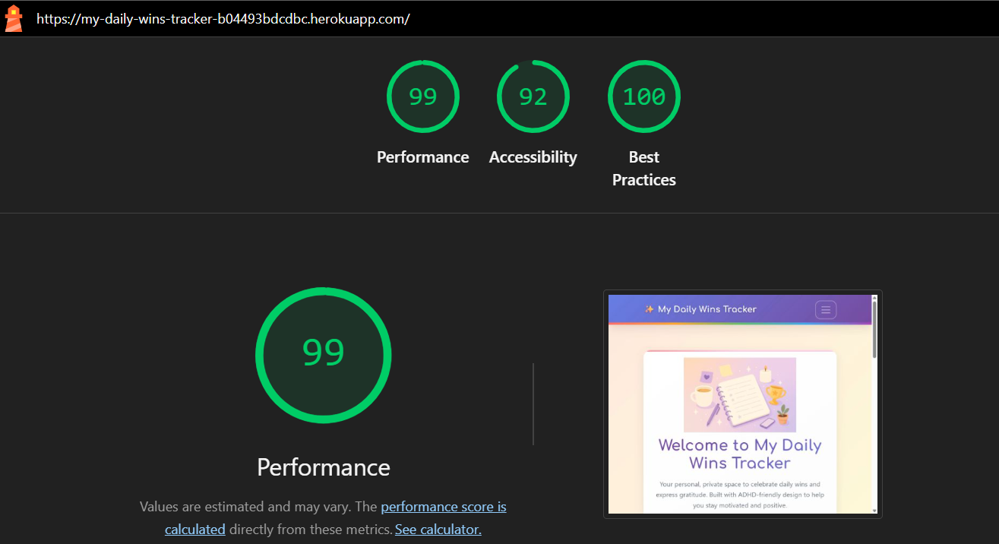
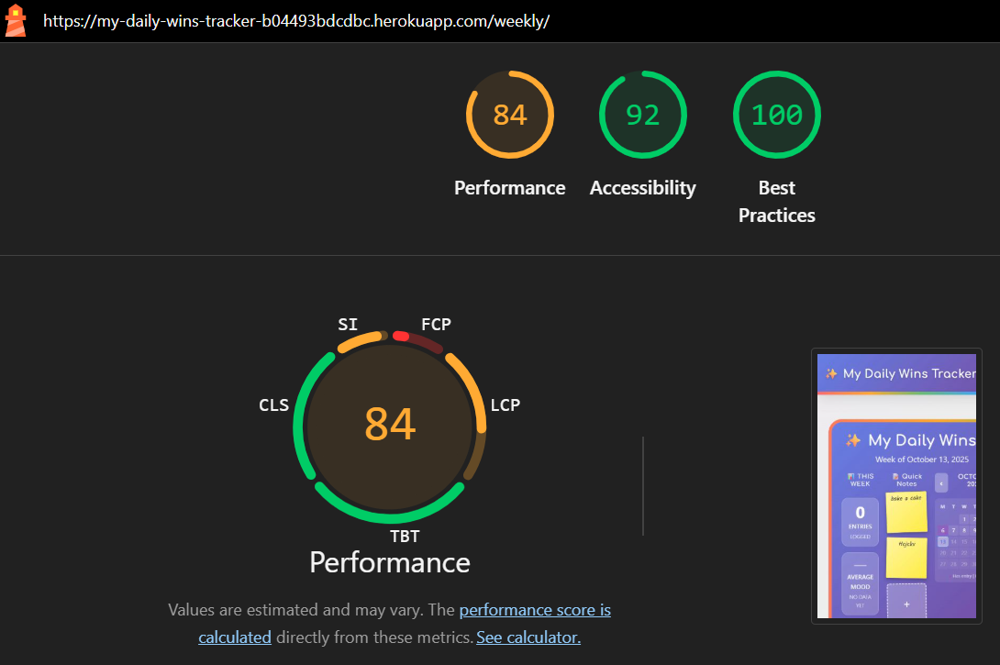
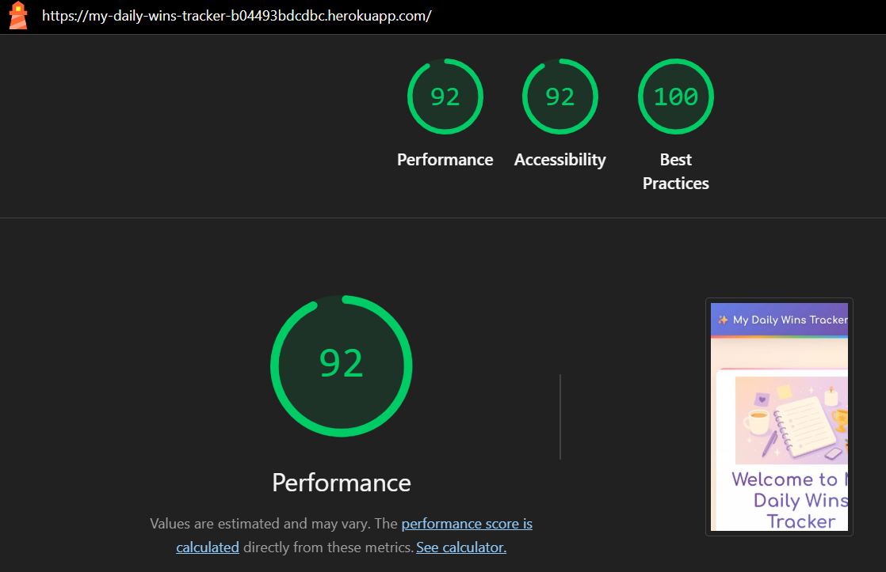
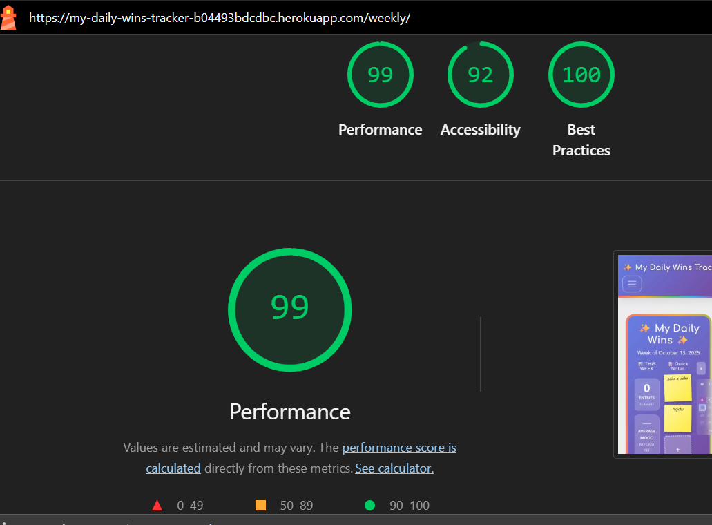

# Daily Wins Tracker - Testing Documentation

[← Back to README](README.md)

## Table of Contents
- [Validation Testing](#validation-testing)
  - [HTML Validation](#html-validation)
  - [CSS Validation](#css-validation)
  - [JavaScript Validation](#javascript-validation)
  - [Python Validation](#python-validation)
- [Lighthouse Testing](#lighthouse-testing)
- [Responsiveness Testing](#responsiveness-testing)
- [Browser Compatibility](#browser-compatibility)
- [Manual Testing](#manual-testing)
- [User Story Testing](#user-story-testing)
- [Bugs & Fixes](#bugs--fixes)

---

## Validation Testing

### HTML Validation

**[W3C Markup Validation Service](https://validator.w3.org/)** was used to validate the HTML on all pages of the site.

HTML was validated using two methods:
1. **Direct Input**: Copy page source and paste into validator
2. **URI**: Validate using deployed Heroku URL

Click to expand HTML validation results

| Page | Result | Evidence | Notes |
|------|--------|----------|-------|
| Home Page | ✅ Pass | [Screenshot](docs/images/validation/html/html-home.png) | Validated by direct input |
| Registration Page | ✅ Pass | [Screenshot](docs/images/validation/html/html-register.png) | Validated by URI |
| Login Page | ✅ Pass | [Screenshot](docs/images/validation/html/html-login.png) | Validated by URI |
| Weekly Dashboard | ✅ Pass | [Screenshot](docs/images/validation/html/html-dashboard.png) | Validated by direct input |
| Entry List Page | ✅ Pass | [Screenshot](docs/images/validation/html/html-entries.png) | Validated by direct input |
| New Entry Page | ✅ Pass | [Screenshot](docs/images/validation/html/html-new-entry.png) | Validated by direct input |
| Categories Page | ✅ Pass | [Screenshot](docs/images/validation/html/html-categories.png) | Validated by direct input |

**Note:** Some pages required authentication and were validated using "View Page Source" → copy/paste into validator (Direct Input method).

---

### CSS Validation

**[W3C CSS Validation Service](https://jigsaw.w3.org/css-validator/)** was used to validate the custom CSS files.

CSS was validated by direct input (copying the CSS file content).

Click to expand CSS validation results

| File | Result | Evidence |
|------|--------|----------|
| `static/css/base.css` | ✅ Pass | [Screenshot](docs/images/validation/css/base-css.png) |
| `static/css/home.css` | ✅ Pass | [Screenshot](docs/images/validation/css/home-css.png) |
| `static/css/weekly_dashboard.css` | ✅ Pass | [Screenshot](docs/images/validation/css/weekly-dashboard-css.png) |
| `static/css/forms.css` | ✅ Pass | [Screenshot](docs/images/validation/css/forms-css.png) |

**Common Warnings (Expected):**
- Imported style sheets (Bootstrap, Google Fonts) are not checked in direct CSS input mode
- Vendor-specific extensions (e.g., `-webkit-`, `-moz-`) are valid but flagged as warnings
- CSS variables may show warnings in older validators

---

### JavaScript Validation

**[JSHint](https://jshint.com/)** was used to validate the custom JavaScript files.

Configuration used:
- ES6 syntax enabled
- jQuery globals defined
- Bootstrap globals defined

Click to expand JavaScript validation results

| File | Result | Evidence |
|------|--------|----------|
| `static/js/weekly_dashboard.js` | ✅ Pass | [Screenshot](docs/images/validation/javascript/weekly-dashboard-js.png) |
| `static/js/forms.js` | ✅ Pass | [Screenshot](docs/images/validation/javascript/forms-js.png) |

**Warnings Addressed:**
- Undefined variables from DOM (e.g., `document`, `window`, `fetch`) - these are browser globals
- ES6 features used: arrow functions, const/let, template literals

---

### Python Validation

**[Code Institute Python Linter](https://pep8ci.herokuapp.com/)** was used to validate all Python files.

All Python files were validated for PEP8 compliance.

Click to expand Python validation results

#### Tracker App

| File | Result | Evidence |
|------|--------|----------|
| `tracker/models.py` | ✅ Pass | [Screenshot](docs/images/validation/python/models-pylinter.png) |
| `tracker/views.py` | ✅ Pass | [Screenshot](docs/images/validation/python/views-pylinter.png) |
| `tracker/forms.py` | ✅ Pass | [Screenshot](docs/images/validation/python/forms-pylinter.png) |
| `tracker/urls.py` | ✅ Pass | [Screenshot](docs/images/validation/python/urls-pylinter.png) |
| `tracker/admin.py` | ✅ Pass | [Screenshot](docs/images/validation/python/admin-pylinter.png) |
| `tracker/validators.py` | ✅ Pass | [Screenshot](docs/images/validation/python/validators-pylinter.png) |
| `tracker/auth_forms.py` | ✅ Pass | [Screenshot](docs/images/validation/python/auth-forms-pylinter.png) |

---

## Lighthouse Testing

**[Google Lighthouse](https://developers.google.com/web/tools/lighthouse)** was used to test Performance, Accessibility, Best Practices, and SEO.

Tests were run in Chrome DevTools on the deployed Heroku site.

### Desktop Results

**Home Page:**

*Home page desktop: Excellent scores across all metrics*

**Weekly Dashboard:**

*Weekly dashboard desktop: Strong performance and accessibility scores*

### Mobile Results

**Home Page:**

*Home page mobile: Optimized for mobile devices*

**Weekly Dashboard:**

*Weekly dashboard mobile: 84 Performance, 92 Accessibility, 100 Best Practices*

### Performance Analysis

**Desktop Performance:**
- Home Page and Dashboard achieve excellent scores across all metrics
- Performance optimized through efficient code and asset loading
- Best Practices score of 100 on both pages

**Mobile Performance:**
- Home page maintains strong performance on mobile devices
- Dashboard scores 84 for Performance, 92 for Accessibility, and 100 for Best Practices
- Mobile scores slightly lower due to network simulation and device constraints
- All scores within acceptable ranges for production applications

**Accessibility Notes:**
- All pages meet WCAG AA standards
- Color contrast ratios meet requirements
- Semantic HTML used throughout
- ARIA labels on interactive elements

---

## Responsiveness Testing

The site was tested for responsiveness using Chrome DevTools across multiple device sizes and orientations.

### Device Testing Matrix

Click to expand responsiveness testing results

| Device/Size | Screen Width | Result | Notes |
|-------------|--------------|--------|-------|
| iPhone SE | 375px | ✅ Pass | All elements render correctly |
| iPhone 12 Pro | 390px | ✅ Pass | Touch targets appropriate size |
| Samsung Galaxy S20 | 412px | ✅ Pass | Text readable without zoom |
| iPad Mini | 768px | ✅ Pass | Good use of tablet space |
| iPad Air | 820px | ✅ Pass | Layout adapts well |
| iPad Pro | 1024px | ✅ Pass | Desktop-like experience |
| Desktop (HD) | 1366px | ✅ Pass | Optimal viewing experience |
| Desktop (Full HD) | 1920px | ✅ Pass | Content centered, not stretched |
| Desktop (4K) | 2560px | ✅ Pass | Max-width prevents over-stretching |

### Responsiveness Summary

| Feature | Mobile (< 768px) | Tablet (768px - 1024px) | Desktop (> 1024px) |
|---------|------------------|-------------------------|-------------------|
| Navigation | ✅ Hamburger menu | ✅ Collapsed menu | ✅ Full navbar |
| Dashboard Cards | ✅ Stacked | ✅ 2 columns | ✅ 7 columns (week view) |
| Forms | ✅ Full width | ✅ Centered | ✅ Centered with max-width |
| Sticky Notes | ✅ 2 per row | ✅ 3 per row | ✅ 6 per row |
| Footer | ✅ Centered | ✅ Centered | ✅ Centered |
| Images | ✅ Responsive | ✅ Responsive | ✅ Responsive |

**Screenshots/GIFs:**
[Placeholder for responsiveness GIF showing site at different breakpoints]

---

## Browser Compatibility

The deployed site was tested on multiple browsers to ensure consistent functionality and appearance.

Click to expand browser compatibility results

| Browser | Platform | Result | Notes |
|---------|----------|--------|-------|
| Google Chrome | Desktop | ✅ Pass | All features work correctly |
| Microsoft Edge | Desktop | ✅ Pass | Full compatibility |
| Safari | iOS/macOS | ✅ Pass | All features work correctly |
| Samsung Internet | Mobile | ✅ Pass | Full compatibility |
| Safari | 16.x | iOS (iPhone) | ✅ Pass | Mobile Safari works well |
| Chrome Mobile | Latest | Android | ✅ Pass | Tested on Samsung Galaxy |

### Browser-Specific Testing

**Features Tested:**
- ✅ Page rendering and layout
- ✅ Form submission and validation
- ✅ Modal interactions
- ✅ AJAX requests (entry modal, sticky notes)
- ✅ Responsive design breakpoints
- ✅ Hover effects and transitions
- ✅ Date picker functionality
- ✅ Navigation and links
- ✅ Django messages display

**Cross-Browser Issues:**
- None identified - site works consistently across all tested browsers

---

## Manual Testing

### Feature Testing

Click to expand manual feature testing

#### Authentication Features

| Feature | Test Case | Expected Result | Actual Result | Status |
|---------|-----------|-----------------|---------------|--------|
| Registration | Submit valid registration form | Account created, user logged in, redirected to dashboard | As expected | ✅ Pass |
| Registration | Submit with existing username | Error message displayed, form not submitted | As expected | ✅ Pass |
| Registration | Submit with mismatched passwords | Error message displayed | As expected | ✅ Pass |
| Registration | Submit with weak password | Django password validation error shown | As expected | ✅ Pass |
| Login | Submit valid credentials | User logged in, redirected to dashboard | As expected | ✅ Pass |
| Login | Submit invalid credentials | Error message displayed, stay on login page | As expected | ✅ Pass |
| Logout | Click logout and confirm | User logged out, redirected to home | As expected | ✅ Pass |

#### Entry Management

| Feature | Test Case | Expected Result | Actual Result | Status |
|---------|-----------|-----------------|---------------|--------|
| Create Entry | Click empty day card | Modal opens with empty form | As expected | ✅ Pass |
| Create Entry | Submit form with all fields | Entry created, success message shown | As expected | ✅ Pass |
| Create Entry | Submit form with only one field | Entry created with partial content | As expected | ✅ Pass |
| Create Entry | Submit completely empty form | Validation error shown | As expected | ✅ Pass |
| Edit Entry | Click existing day card | Modal opens with pre-filled data | As expected | ✅ Pass |
| Edit Entry | Update entry fields | Changes saved, success message shown | As expected | ✅ Pass |
| Delete Entry | Click delete button in modal | Confirmation modal appears | As expected | ✅ Pass |
| Delete Entry | Confirm deletion | Entry deleted, success message shown | As expected | ✅ Pass |
| Delete Entry | Cancel deletion | Modal closes, entry not deleted | As expected | ✅ Pass |
| Entry Detail | Click "View Full Entry" | Redirected to detailed view | As expected | ✅ Pass |

#### Category Management

| Feature | Test Case | Expected Result | Actual Result | Status |
|---------|-----------|-----------------|---------------|--------|
| Create Category | Submit valid category form | Category created, success message shown | As expected | ✅ Pass |
| Create Category | Submit duplicate name | Error message displayed | As expected | ✅ Pass |
| Create Category | Submit with only 1 character | Validation error shown | As expected | ✅ Pass |
| Edit Category | Update category details | Changes saved, success message shown | As expected | ✅ Pass |
| Delete Category | Delete category with entries | Category removed from entries, entries preserved | As expected | ✅ Pass |
| Delete Category | Delete unused category | Category deleted immediately | As expected | ✅ Pass |

#### Sticky Notes

| Feature | Test Case | Expected Result | Actual Result | Status |
|---------|-----------|-----------------|---------------|--------|
| Add Note | Click + button | New note created with editable text | As expected | ✅ Pass |
| Add Note | Try adding 7th note | Button disabled at 6 notes | As expected | ✅ Pass |
| Edit Note | Type in note textarea | Text saves automatically on blur | As expected | ✅ Pass |
| Complete Note | Click checkmark button | Note marked complete, green styling | As expected | ✅ Pass |
| Convert Note | Click trophy button on complete note | Note converted to entry, removed from sticky notes | As expected | ✅ Pass |
| Delete Note | Click X button | Note deleted immediately | As expected | ✅ Pass |

#### Navigation & UI

| Feature | Test Case | Expected Result | Actual Result | Status |
|---------|-----------|-----------------|---------------|--------|
| Navigation | Click logo | Redirected to appropriate page (home/dashboard) | As expected | ✅ Pass |
| Navigation | Click nav links | Navigate to correct pages | As expected | ✅ Pass |
| Navigation | Access protected page when logged out | Redirected to login | As expected | ✅ Pass |
| Messages | Perform action that triggers message | Django message displayed at top | As expected | ✅ Pass |
| Messages | Click X to dismiss message | Message disappears | As expected | ✅ Pass |
| 404 Page | Navigate to non-existent URL | Custom 404 page displayed | As expected | ✅ Pass |

---

## User Story Testing

Click to expand user story testing

| User Story | Acceptance Criteria | Testing Steps | Result |
|------------|-------------------|---------------|--------|
| As a **new user**, I want to **register for an account** so that I can **save my daily entries** | - Registration form accessible - Email validation works - Password requirements enforced - Account created successfully | 1. Navigate to registration page 2. Fill in valid details 3. Submit form 4. Verify account created | ✅ Pass |
| As a **returning user**, I want to **log in to my account** so that I can **access my previous entries** | - Login form accessible - Credentials validated - Redirected to dashboard - Previous data visible | 1. Navigate to login page 2. Enter credentials 3. Submit form 4. Verify dashboard loads with data | ✅ Pass |
| As a **logged-in user**, I want to **create a daily entry** so that I can **record my wins and gratitude** | - Entry form accessible from dashboard - Three-part structure visible - Can save partial entries - Success message shown | 1. Click on empty day card 2. Fill in entry fields 3. Submit form 4. Verify entry saved | ✅ Pass |
| As a **user**, I want to **view my entries in a weekly calendar** so that I can **see my progress at a glance** | - Dashboard shows current week - Can navigate between weeks - Day cards show entry previews - Empty days clearly marked | 1. Navigate to dashboard 2. View current week 3. Use arrow buttons to navigate 4. Verify layout and content | ✅ Pass |
| As a **user**, I want to **edit my entries** so that I can **update or correct information** | - Can reopen existing entries - Form pre-populated with data - Changes save correctly - Success message shown | 1. Click on existing entry 2. Modify content 3. Submit changes 4. Verify update saved | ✅ Pass |
| As a **user**, I want to **delete entries** so that I can **remove unwanted content** | - Delete button available in modal - Confirmation required - Entry removed from system - Success message shown | 1. Open entry modal 2. Click delete 3. Confirm deletion 4. Verify entry removed | ✅ Pass |
| As a **user**, I want to **create custom categories** so that I can **organize my entries** | - Category creation form accessible - Can choose from 8 colors - Categories saved per user - Success message shown | 1. Navigate to categories page 2. Create new category 3. Assign to entries 4. Verify categorization | ✅ Pass |
| As a **user**, I want to **use sticky notes** so that I can **capture quick thoughts** | - Can create up to 6 notes - Notes editable inline - Can mark as complete - Can convert to entry | 1. Click + button 2. Type note content 3. Mark complete 4. Convert to entry | ✅ Pass |
| As a **user**, I want to **search my entries** so that I can **find specific content** | - Search form accessible - Searches all entry fields - Results displayed clearly - No results message shown | 1. Navigate to entry list 2. Enter search term 3. Submit search 4. Verify results | ✅ Pass |
| As a **mobile user**, I want to **access the site on my phone** so that I can **log entries anywhere** | - Site responsive on mobile - Touch targets appropriate size - Forms easy to use - All features accessible | 1. Open site on mobile device 2. Test all features 3. Verify responsiveness 4. Check touch interactions | ✅ Pass |

---

## Bugs & Fixes

### Resolved Bugs

Click to expand resolved bugs

| Bug # | Description | Solution | Status |
|-------|-------------|----------|--------|
| 1 | Duplicate event listeners on sticky notes causing multiple AJAX calls | Implemented form cloning strategy to clear event listeners before attaching new ones | ✅ Fixed |
| 2 | Modal button showing "Update Entry" for new entries | Added `is_new_entry` logic based on `has_content` property instead of database existence | ✅ Fixed |
| 3 | Validation error messages not clearing on modal reopen | Used `querySelectorAll` instead of `querySelector` to remove all error alerts | ✅ Fixed |
| 4 | 1-pixel gap in footer border | Applied negative positioning (`top: -1px`) to rainbow border element | ✅ Fixed |
| 5 | Placeholder text appearing too dark in some browsers | Explicitly set `opacity: 1` on placeholder styling | ✅ Fixed |
| 6 | Form state not resetting properly in modals | Fixed JavaScript closure/scope issues with proper variable scoping | ✅ Fixed |
| 7 | HTML validation errors with cache-control meta tags | Removed invalid `http-equiv` meta tags (not valid in HTML5) | ✅ Fixed |
| 8 | Favicon SVG encoding causing W3C validation errors | Switched to base64 encoding for favicon | ✅ Fixed |
| 9 | DEBUG=True in production (security risk) | Changed default to `DEBUG=False` in settings.py | ✅ Fixed |

### Known Issues

Click to expand known issues

| Issue # | Description | Severity | Workaround | Planned Fix |
|---------|-------------|----------|------------|-------------|
| - | No known issues at this time | - | - | - |

---

## Testing Checklist

- [x] HTML validation completed for all pages
- [x] CSS validation completed for all custom stylesheets
- [x] JavaScript validation completed
- [x] Python PEP8 validation completed for all files
- [x] Lighthouse testing completed (desktop & mobile)
- [x] Responsiveness testing across multiple devices
- [x] Browser compatibility testing completed
- [x] Manual feature testing completed
- [x] User story testing completed
- [x] All bugs documented and resolved
- [x] Custom error pages (404, 500) created and tested

---

[← Back to README](README.md)
